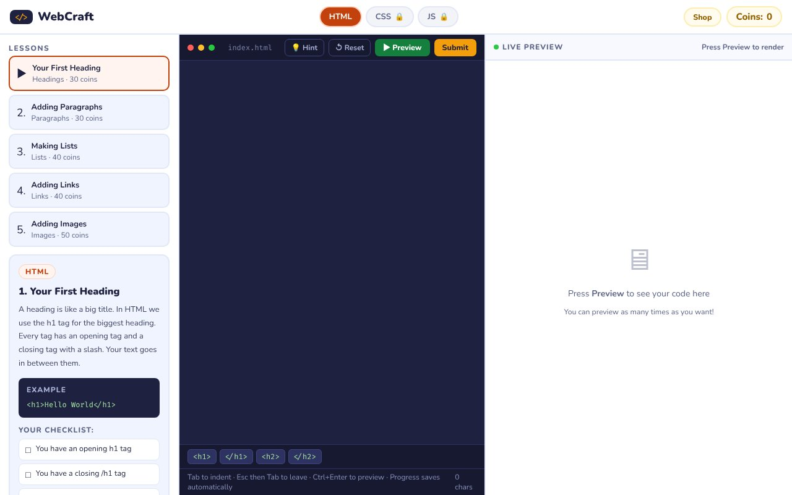
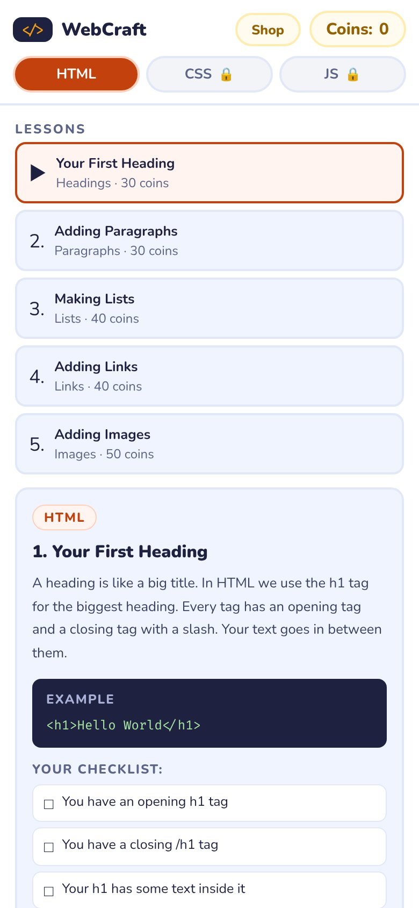

# WebCraft

**Learn HTML, CSS and JavaScript one small step at a time.**

🔗 **Live site:** https://irbala.github.io/WebCraft/

<p align="center">
  <a href="https://irbala.github.io/WebCraft/"></a>
  <a href="https://irbala.github.io/WebCraft/"></a>
</p>

<p align="center"><sub>Click a screenshot to open the live site.</sub></p>


WebCraft is a beginner-friendly coding playground. Each lesson explains one idea, shows an example, and gives you a checklist. Write your code in the editor, see it in the live preview, and submit it to earn coins. Spend coins in the shop to unlock new worlds.

## Worlds

| World | Lessons | What you learn | Unlock cost |
|---|---|---|---|
| 🟠 HTML | 5 | Headings, paragraphs, lists, links, images | Free |
| 🔵 CSS | 4 | Colours, fonts, spacing and boxes, flexbox | 100 coins |
| 🟡 JavaScript | 4 | Alerts, changing text, changing styles, if / else | 150 coins |

## Features

- **Live preview** that runs your HTML, CSS and JavaScript, including `alert()` pop-ups
- **Checklist for every lesson**: each item turns green as you get it right. Commented-out code doesn't count.
- **Hint** button that tells you which step to work on next
- **Reset** button that brings back the lesson's starter code
- **Next** button to move on once a lesson is done
- **Code chips** that insert common tags and snippets with one click
- **Progress saves automatically** in your browser: coins, finished lessons, unlocked worlds and unsent code
- **A finish screen** when you complete every lesson, with an option to start over
- **Works on phones, tablets and desktops**
- **Keyboard friendly**: every control can be reached with Tab. In the editor, Tab indents; press Esc then Tab to move on.

## Keyboard shortcuts

| Keys | Action |
|---|---|
| `Tab` | Indent inside the editor |
| `Esc`, then `Tab` | Leave the editor |
| `Ctrl` + `Enter` (`Cmd` + `Enter` on Mac) | Run the preview |
| `Esc` | Close the shop or finish screen |

## Design Decisions

- **A colour for each world.** HTML is orange, CSS is blue and JavaScript is gold, echoing the colours people already link with each language, so learners always know which world they are in. <!-- guess: Fay, please confirm or edit -->
- **Three panels, like a real editor.** Lesson on the left, a dark code editor in the middle and a white live preview on the right. The dark editor sets "writing code" apart from "seeing the result".
- **Small wins.** Every lesson has a checklist that turns green item by item, coins for finishing, and new worlds to unlock, so beginners get steady feedback instead of one pass/fail at the end.
- **Fair checks.** Code is checked with comments stripped out, so commented-out code never counts as done.
- **Safe preview.** Student code runs in a sandboxed iframe, so a mistake can't break the page around it.
- **No build step.** Plain HTML, CSS and JavaScript split into four readable files, so learners can open the source and understand how the app itself works.

## Accessibility

Checked on 19 November 2026 with [axe-core](https://github.com/dequelabs/axe-core) 4.10, the engine behind Lighthouse's accessibility score, against WCAG 2.1 A and AA plus axe's best-practice rules. Every page was tested in a desktop browser.

| Page | Issues | Rules passed |
|---|---|---|
| `index.html` | ✅ 0 issues | 38 |

Fixed in this round:

- Darkened the orange, gold and muted text colours so every label, tab and hint passes 4.5:1 contrast.
- The Run button is a deeper green, and the Submit button and coin badges now use dark text on amber.
- Lighter text in the dark editor footer and example box, so it is readable on the dark background.

## Run it locally

WebCraft has no build step or dependencies. Download or clone the repo and open `index.html` in your browser:

```bash
git clone https://github.com/irbala/WebCraft.git
cd WebCraft
open index.html   # or double-click the file
```

## Files

| File | What's in it |
|---|---|
| `index.html` | The page structure |
| `styles.css` | All the styles |
| `lessons.js` | The lessons for each world |
| `app.js` | How the app works: progress, editor, preview, checks and shop |

## Adding a lesson

Lessons live in the `WORLDS` object in `lessons.js`. Each lesson looks like this:

```js
{
  title: 'Your First Heading',
  short: 'Headings',
  desc: 'What the student is learning…',
  example: '<h1>Hello World</h1>',
  starter: '',                      // code already in the editor
  chips: ['<h1>', '</h1>'],         // one-click snippets
  checks: [
    { label: 'You have an opening h1 tag', test: function(c){ return /<h1[\s>]/i.test(c); } }
  ],
  coins: 30
}
```

Each check's `test` receives the student's code with comments removed and returns `true` when the step is done.

## Notes

- Progress is stored in the browser's `localStorage`, so it stays on that device and browser only. Clearing site data or using a private window starts fresh.
- Student code runs inside a sandboxed preview frame, so it can't affect the main page.

---

Made by [Fay Alabri](https://irbala.github.io/FayAlabri/)
